# Dungeon Delvers

Dungeon Delvers is a team dungeon adventure for the classroom. Your group builds a party of heroes, explores a dark three-floor dungeon, fights monsters, buys supplies from a merchant, and tries to defeat the final boss and escape.

**Play here:** [dungeon-divers.ggkids-japan-428.workers.dev](https://dungeon-divers.ggkids-japan-428.workers.dev/)

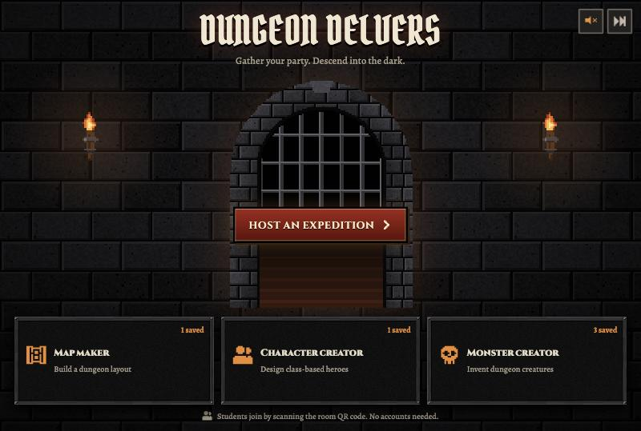

**In this guide**

- [The goal](#the-goal)
- [Joining and building your party](#joining-and-building-your-party)
- [The three stats](#the-three-stats)
- [The four classes](#the-four-classes)
- [Exploring the dungeon](#exploring-the-dungeon)
- [Battles](#battles)
- [Monsters and bosses](#monsters-and-bosses)
- [Items and the merchant](#items-and-the-merchant)
- [Gold, XP and levelling up](#gold-xp-and-levelling-up)
- [How you lose](#how-you-lose)
- [Create your own heroes, monsters and maps](#create-your-own-heroes-monsters-and-maps)
- [Fact sheet and Kahoot questions](#fact-sheet-and-kahoot-questions)
- [For teachers: running a game](#for-teachers-running-a-game)
- [For developers](#for-developers)

---

## The goal

1. Explore each floor and find its **key**.
2. Take the **stairs** down to the next floor.
3. On floor 3, defeat the **boss**. The boss holds the last key.
4. Walk through the **exit** behind the boss to escape. You win!

There are **3 floors**. Up to **8 groups** play at the same time, each with its **own** position, heroes, gold and items.

### Some things are shared between groups

Your group is not alone down there. These things are shared by every group on the floor:

- **Monsters.** If one group defeats a monster, it stays defeated for everyone.
- **Chests.** Each chest can only be opened once, so the first group gets the prize.
- **Keys.** When one group finds a floor's key, the stairs unlock for everyone.
- **The map.** Tiles discovered by one group are revealed for all groups.

Only one group can fight a monster at a time. If another group is already fighting it, you have to wait.

---

## Joining and building your party

Scan the QR code on your teacher's screen, then:

1. Type a **group name**.
2. Add **1 to 4 heroes**. Each hero needs a different name.
3. For each hero, choose a **class** and a **colour**, then roll their stats. You can also pick a saved hero or tap **Choose a random hero**.
4. Tap **Join party**, then wait for your teacher to start the game.

No accounts are needed. Use made-up names, not your personal information, because other groups can see them.

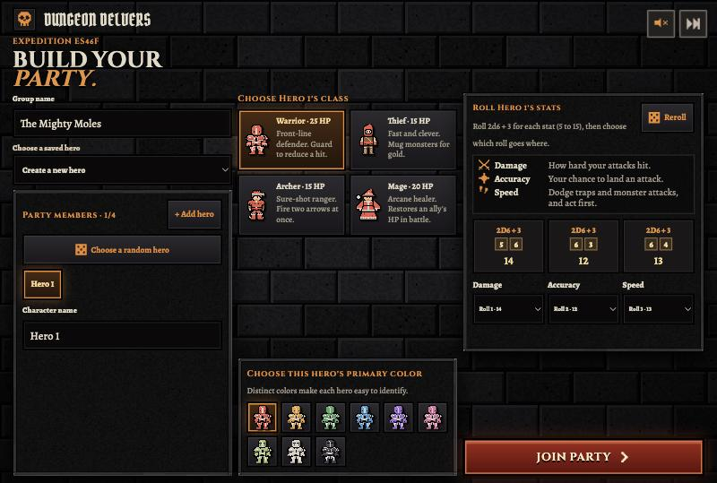

**Every party starts with 2 Healing Potions and 1 Phoenix Feather.**

---

## The three stats

Every hero has three stats. Each one is rolled with **two six-sided dice plus 3**, so a stat is always between **5 and 15**. You roll three numbers, then choose which number goes on which stat.

| Stat | What it does | Why you want it high |
|---|---|---|
| **Damage** (DMG) | How hard your attacks hit | Monsters go down faster |
| **Accuracy** (ACC) | Your chance to land an attack | You miss less often |
| **Speed** (SPD) | Dodging traps, dodging monster attacks, and going first | You get hit less and act sooner |

### What the numbers mean

| Stat value | Chance to hit (Accuracy) | Attack damage (Damage) | Chance to dodge a monster (Speed) | Chance to dodge a trap (Speed) |
|---:|---:|---:|---:|---:|
| 5 | 35% | 3–5 | 15% | 30% |
| 10 | 50% | 6–8 | 30% | 55% |
| 15 | 65% | 9–11 | 45% | 80% |

---

## The four classes

A hero's **class** decides their health (HP) and their special ability. Stats do not change a hero's starting HP.

| Class | HP | Special ability | What it does |
|---|---:|---|---|
| **Warrior** | 25 | **Guard** | Blocks 2 damage from the next attack. Monsters aim for a guarding hero first, so the Warrior can protect the team. |
| **Thief** | 15 | **Mug** | Never misses. Deals half the Thief's Damage and steals **8 gold**. |
| **Archer** | 15 | **Dual Shot** | Fires **2 arrows**. Each arrow rolls to hit separately. |
| **Mage** | 20 | **Heal** | You choose an injured ally and restore up to **5 HP**. Heal does not hurt the monster. |

Using a special ability uses up that hero's turn.

---

## Exploring the dungeon

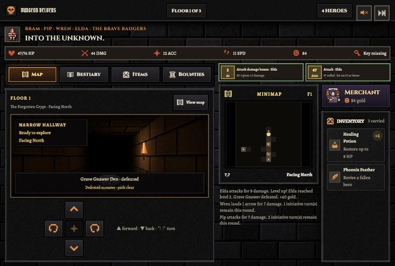

- **Move and turn** with the arrow buttons at the bottom.
- **The minimap** shows the tiles you have discovered. The yellow dot is your party.
- **The top bar** shows your party's total HP and stats, your gold, and whether you have the key.
- **The tabs** open the Bestiary (monster information), Items, and Bounties (monster rewards).
- **The Merchant** is on the side panel, and your items are under him.

### The floors

| Floor | What it is like |
|---|---|
| **Floors 1 and 2** | Made by your class in the Map Maker, or created by the game. A monster may guard the key. |
| **Floor 3** | One of **5 huge mazes**, picked at random. It has many more monsters and traps, and the boss guards the exit. Students cannot design this floor. |

The 5 mazes are **The Coiled Descent**, **The Serpent Galleries**, **The Hollow Warrens**, **The Winding Catacombs** and **The Sundered Halls**.

### Traps

You cannot see a trap until you step on it. When a trap goes off, **every living hero** rolls one 20-sided die and adds their Speed.

- A total of **20 or more** means that hero dodges it.
- Anything lower means that hero loses **4 HP**.

Each group only sets off a trap once.

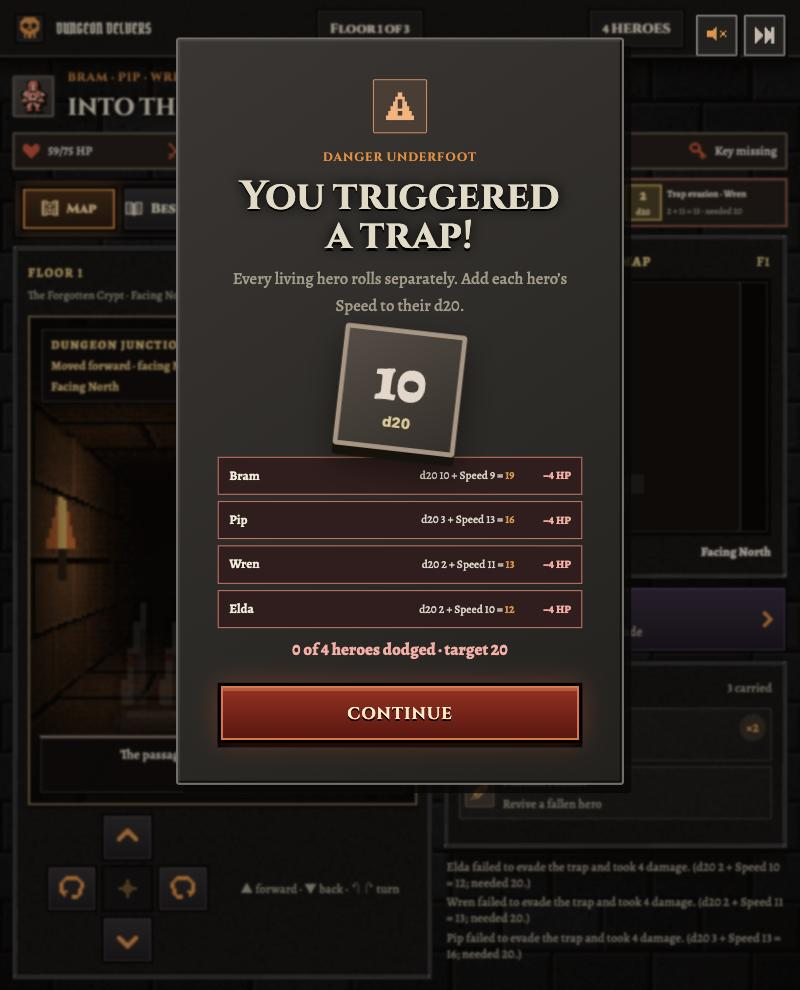

### Chests

A chest gives one random prize, and each prize is equally likely:

- **10–25 gold**
- A Healing Potion
- A Phoenix Feather
- A Bomb

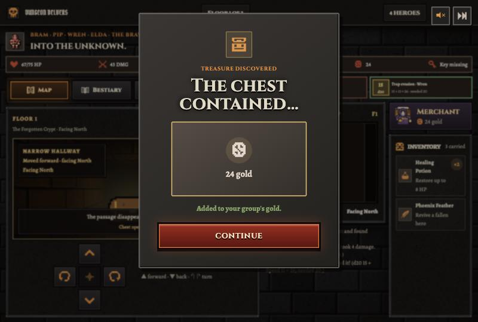

---

## Battles

Stepping onto a monster's tile starts a battle. The monster is on the left and your party is on the right.

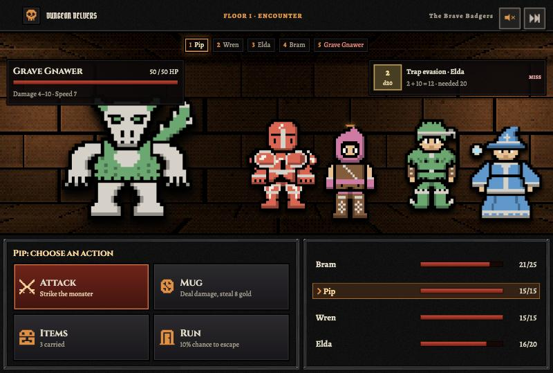

- **The strip at the top** shows the turn order for this round.
- **The bottom left** shows your commands.
- **The bottom right** shows each hero's health.

### Turn order

The **fastest goes first**. Everyone, including the monster, gets one turn each round, in order of Speed from highest to lowest.

### Your commands

| Command | What it does |
|---|---|
| **Attack** | Roll to hit using Accuracy. If it hits, deal damage based on your Damage stat. |
| **Class ability** | Guard, Mug, Dual Shot or Heal, depending on the hero. |
| **Items** | Use something from your inventory. Most items use up your turn. |
| **Run** | A **10% chance** to escape. If it fails, you lose your turn. |

### Running away

Running rarely works, but each hero can try on their turn. If it works, your party returns to the tile you came from. **The monster stays there**, and if you step back on its tile you fight it again, with its health back to full.

A **Smoke Bomb** always lets you escape.

### Healing

When the Mage uses Heal, you choose who to heal. Heroes already at full health are greyed out.

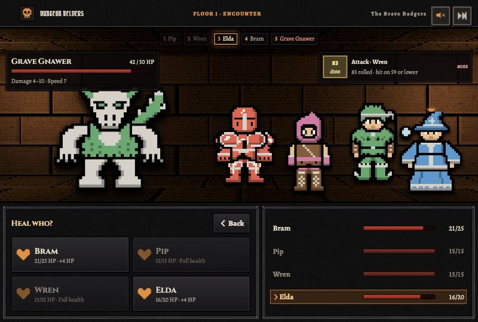

### When the monster attacks

A normal monster attacks **one hero** each round. A hero can **dodge**: their chance is **Speed × 3%**. If they dodge, they take no damage.

Monsters aim at a hero who is guarding first. Otherwise they usually hit the hero who just took a turn.

### Winning

When the monster's HP reaches 0, your group gets its **bounty** in gold.

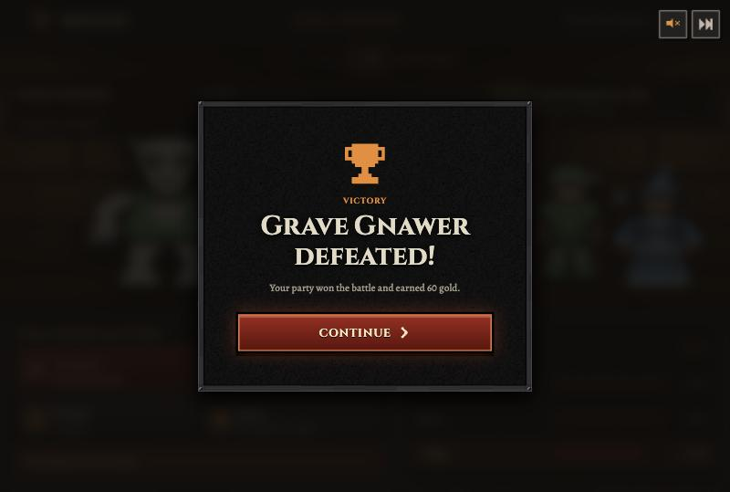

---

## Monsters and bosses

### Normal monsters

Monsters are designed by students in the Monster Creator. They get stronger when they fight bigger parties, so every party size gets a fair fight.

| Heroes in your party | Monster HP | Monster damage |
|---:|---:|---:|
| 1 | 12 | × 0.75 |
| 2 | 20 | × 1 |
| 3 | 35 | × 1.25 |
| 4 | 50 | × 1.75 |

**A normal monster can never hit for more than 10 damage.** The weakest hero has 15 HP, so a healthy hero can't be knocked out in one hit.

The battle screen shows a monster's real damage for your party. The Bestiary shows its original, unscaled numbers.

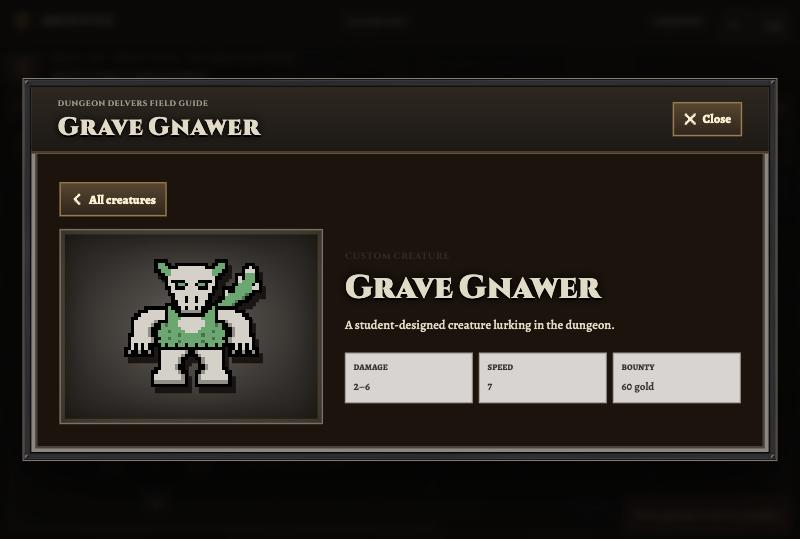

### Bosses

A boss waits on floor 3. One of 5 is chosen at random. Bosses are **always 90 HP**, however many heroes you have, and **each attack hits up to 3 heroes at once**. Every hero rolls their own dodge.

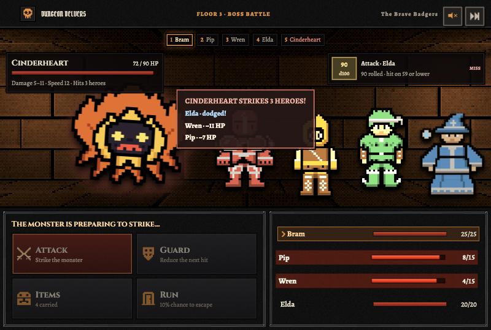

| Boss | Damage per hit | Speed | Bounty |
|---|---:|---:|---:|
| **The Hollow King** | 5–10 | 10 | 60 gold |
| **Maw of Greed** | 4–9 | 6 | 80 gold |
| **The Unblinking** | 4–10 | 14 | 60 gold |
| **Cinderheart** | 5–11 | 12 | 60 gold |
| **Gloomfang Bloom** | 5–9 | 8 | 60 gold |

---

## Items and the merchant

Items belong to the whole group. Tap an item in your inventory to use it.

| Item | Price | What it does | When can you use it? |
|---|---:|---|---|
| **Healing Potion** | 15 gold | Restores up to **8 HP** to one living hero | Any time |
| **Party Tonic** | 30 gold | Restores up to **5 HP** to every living hero | Any time |
| **Smoke Bomb** | 40 gold | Escapes from a battle, **every time** | Battle only |
| **Bomb** | 50 gold | Deals **12 damage** to a monster | Battle only |
| **Phoenix Feather** | 100 gold | Brings a fallen hero back at **half HP** | Any time |

### The merchant

The merchant travels the dungeon with a huge backpack. Tap his card on the side panel to trade with him. You can do this at any time, except during a battle. Tap him to hear what he has to say!

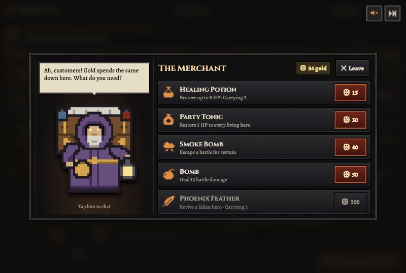

---

## Gold, XP and levelling up

**You earn gold from:**

- Defeating monsters (their **bounty**)
- Chests (10–25 gold)
- The Thief's Mug (8 gold each time)

**Gold** belongs to the whole group, and you spend it at the merchant. The final expedition score counts the gold groups still have at the end, so spending lowers it.

**XP** goes only to the hero who lands the **final blow** on a monster. That hero gains XP equal to the monster's bounty.

**Levelling up** takes **20 XP × your current level**, so level 1 needs 20 XP and level 2 needs 40 XP. Each level gives that hero:

- +1 maximum HP
- +1 Damage
- +1 Accuracy
- +1 Speed

Levelling can raise stats beyond 15, up to **20 Damage**, **18 Accuracy** and **18 Speed**.

---

## How you lose

- A hero at **0 HP** has **fallen** and can't act. A Phoenix Feather brings them back.
- Your group is out only when **all heroes have fallen and you have no Phoenix Feathers left**.
- Other groups keep playing if your group is out.

The game ends when every group has either escaped or been defeated.

---

## Create your own heroes, monsters and maps

Three workshops are on the home screen. Everything saved there is shared with everyone who uses this game, so keep names and designs classroom-friendly.

### Character Creator

Pick a class, change the head, torso, arms, legs and colours, then roll stats. Students can choose saved heroes when they join a game.

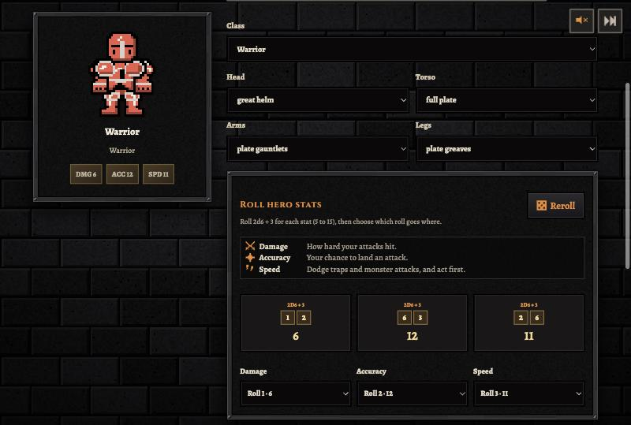

### Monster Creator

Pick a head, torso, arms, legs, tail, wings and colours, then roll the monster's stats with dice. Your monster can then appear in games on any floor.

| Monster stat | How it is rolled | Range |
|---|---|---:|
| Lowest damage | 1 die | 1–6 |
| Highest damage | Lowest damage + 1 die | 2–12 |
| Speed | 3 dice added together | 3–18 |
| Bounty | 2 dice added together × 5 | 10–60 gold |

Bosses can't be made in the Monster Creator.

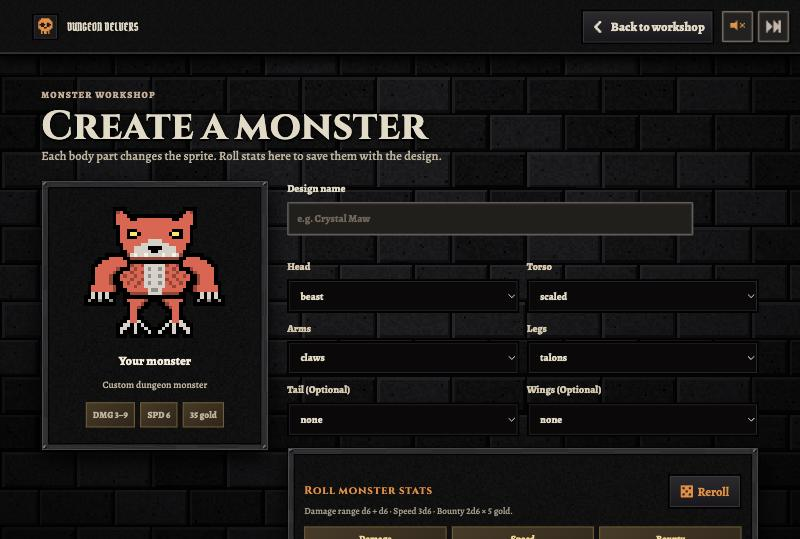

### Map Maker

Draw a dungeon on a **13 × 13 grid** using Path, Start, Monster, Chest, Trap, Key and Exit tiles. A map needs:

- All of its tiles connected
- At least 1 start
- Exactly 1 key
- Exactly 1 exit

Saved maps can be used for floors 1 and 2.

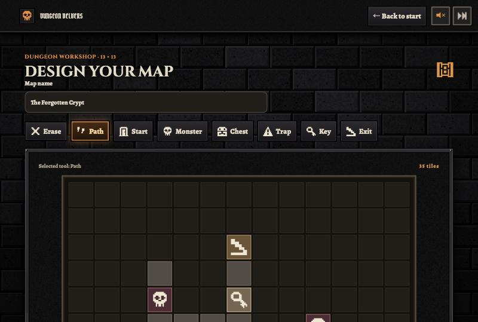

---

## Fact sheet and Kahoot questions

### Words to know

| Word | Meaning |
|---|---|
| **HP** | Hit points, or health. At 0 HP, a hero falls. |
| **XP** | Experience points. Enough XP makes a hero level up. |
| **d6, d20, d100** | A die with 6, 20 or 100 sides. |
| **Stat** | A number showing what a hero is good at: Damage, Accuracy or Speed. |
| **Bounty** | The gold reward for defeating a monster. |
| **Party** | A group's team of 1 to 4 heroes. |
| **Fallen** | A hero at 0 HP who can't act until revived. |

### Key numbers

| Fact | Number |
|---|---|
| Floors in the dungeon | 3 |
| Groups in one game (maximum) | 8 |
| Heroes in a group (maximum) | 4 |
| Heroes in one game (maximum) | 32 |
| Classes | 4 |
| Lowest and highest rolled stat | 5 and 15 |
| Warrior / Mage / Thief / Archer HP | 25 / 20 / 15 / 15 |
| Starting items | 2 Healing Potions, 1 Phoenix Feather |
| Roll needed to dodge a trap (d20 + Speed) | 20 or more |
| Trap damage | 4 HP |
| Chance that Run works | 10% |
| Most damage from a normal monster's hit | 10 |
| Boss HP | 90 |
| Heroes a boss can hit at once | 3 |
| Number of bosses / floor 3 mazes | 5 / 5 |
| Monster HP against a party of 4 | 50 |
| Mage Heal | Up to 5 HP |
| Thief's Mug | 8 gold |
| Price order, cheapest to dearest | Potion 15, Tonic 30, Smoke Bomb 40, Bomb 50, Feather 100 |

### Sample Kahoot questions

The correct answer is in **bold**.

1. What does the **Accuracy** stat do? **Your chance to land an attack** / How hard you hit / Your turn order / Your HP
2. Which stat helps you dodge traps? Damage / Accuracy / **Speed** / HP
3. Which class has the most HP? **Warrior** / Thief / Archer / Mage
4. Which class can heal allies? Warrior / Thief / Archer / **Mage**
5. Which ability never misses and steals gold? Guard / **Mug** / Dual Shot / Heal
6. What number do you need to dodge a trap, after adding your Speed to your d20? 10 / 15 / **20** / 25
7. What is the chance that Run works? **10%** / 25% / 50% / 100%
8. What happens if you step back onto a monster you ran away from? Nothing / You get its gold / **You fight it again, at full health** / It follows you
9. Which item is the most expensive? Healing Potion / Bomb / Smoke Bomb / **Phoenix Feather**
10. Which item always lets you escape from a battle? **Smoke Bomb** / Bomb / Party Tonic / Phoenix Feather
11. How many heroes can a boss hit with one attack? 1 / 2 / **3** / 4
12. What is the most damage a normal monster can do in one hit? 5 / **10** / 15 / 20
13. Who gets the XP for defeating a monster? Everyone / The Warrior / **The hero who lands the final blow** / Nobody
14. When is a group out of the game? When one hero falls / When they run out of gold / **When all heroes have fallen and they have no Phoenix Feathers** / After floor 2
15. Who decides which ally the Mage heals? The game / The monster / **The player** / The teacher

---

## For teachers: running a game

1. On the home screen, tap **Host an expedition**.
2. Show the screen to the class. Groups scan the **QR code** or use the room code link.
3. When all groups have joined, tap **Enter the dungeon**. Groups can't join after the game starts.

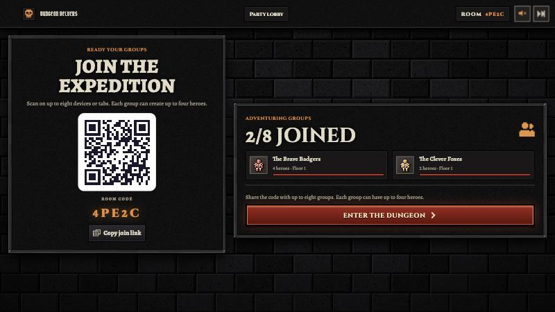

Keep the host screen open during play. It shows the shared map, each group's health and gold, active battles and the game log. **Return to lobby** restarts the game with the same groups.

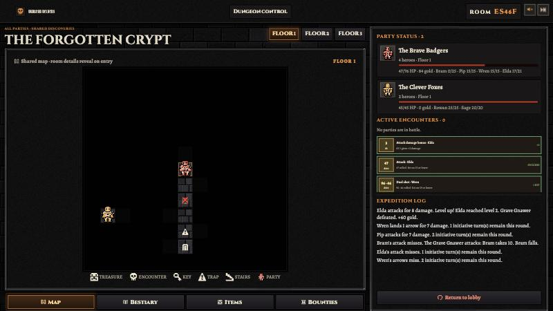

**Good to know**

- **Devices:** the player screens are designed for iPads, and the host screen for a 1920 × 1080 display.
- **Stay in the same tab:** each group's iPad remembers its group in that browser tab. Refreshing is fine, but a new tab won't remember the group.
- **Add monsters first:** normal monsters come from the Monster Creator. With an empty library, rooms have no monsters and only the boss remains.
- **Saved designs are safe:** deleting a saved design or map requires the teacher's delete key.
- **Old rooms:** rooms not used for 24 hours may be removed.

The music controls are at the top right of every screen.

---

## For developers

The game is built on vinext and runs as a Cloudflare Worker with a D1 database. It needs Node.js 22.13 or newer and pnpm 11.25.

```text
pnpm install
pnpm dev
pnpm build
pnpm lint
```

| To change | Look in |
|---|---|
| Item names and prices | `app/items.ts` |
| Floor 3 mazes | `app/boss-floors.ts` |
| Bosses | `app/bosses.ts` |
| Rolled stat limits and the trap target | `app/creations.ts` |
| Battle rules and monster scaling | `app/api/game/route.ts` |
| Delete key | `app/delete-key.ts` (stores a hash, and explains how to change it) |

**Deploying:** Cloudflare builds and deploys automatically when changes reach `main`, using `pnpm deploy:cloudflare`. Make changes on a separate branch first, because `main` updates the live game. To deploy by hand on Windows, run `SETUP_AND_DEPLOY.bat`. Database migrations are never applied automatically.

**Running on a classroom network without the hosted site:** on the host computer, double-click `START_GAME.bat` (Windows) or `START_GAME.command` (macOS), keep the window open, and open the address it prints on devices on the same Wi-Fi. Some school networks block this, so test before class.
